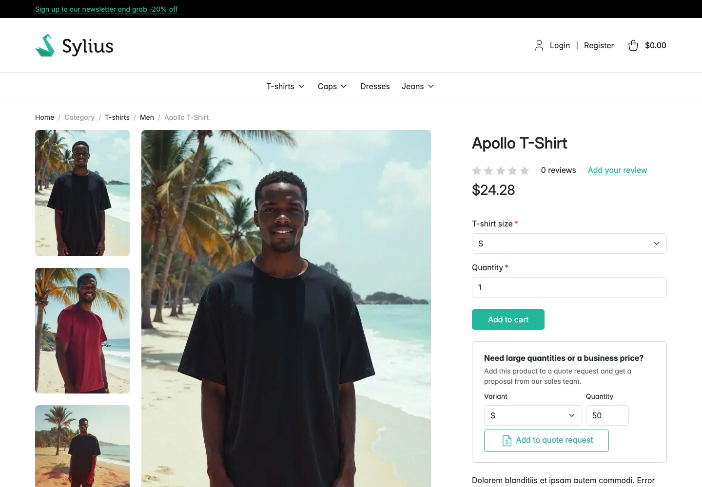
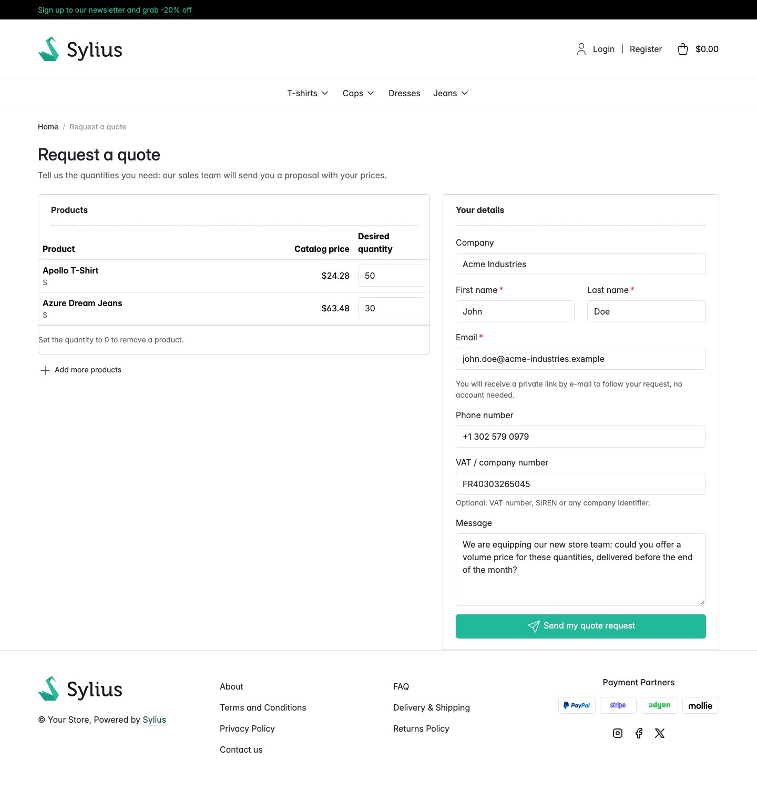
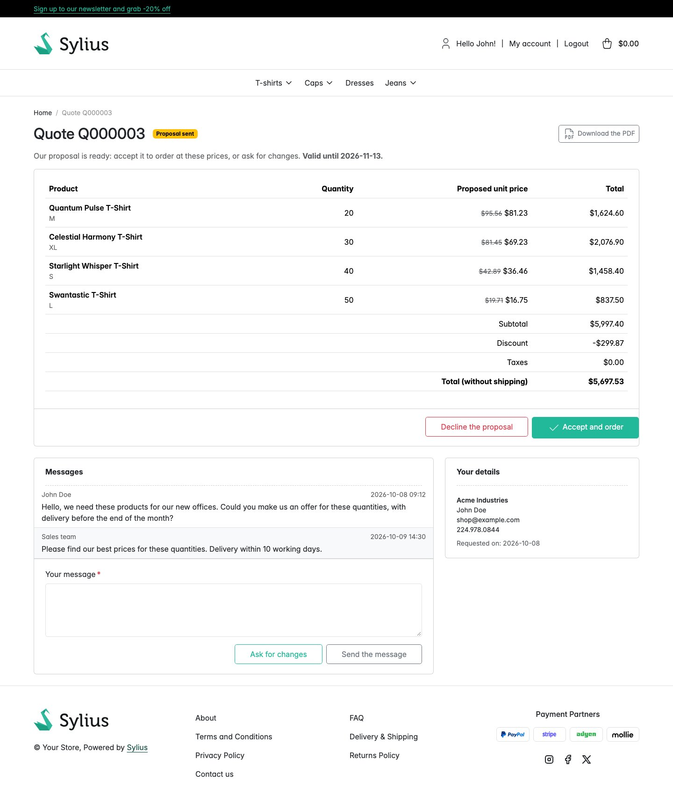
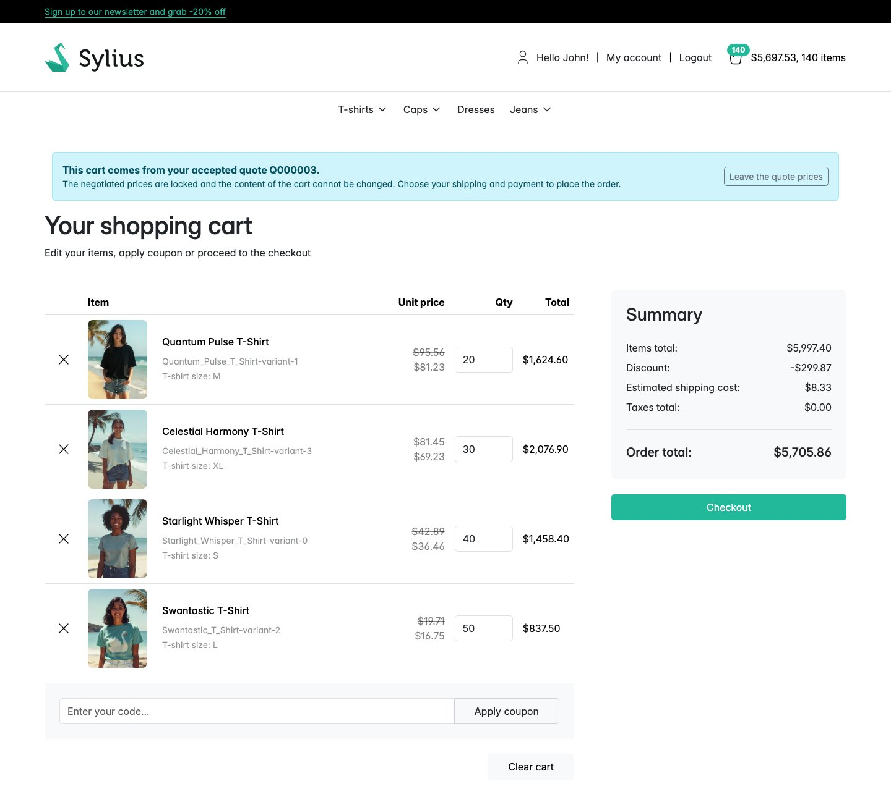
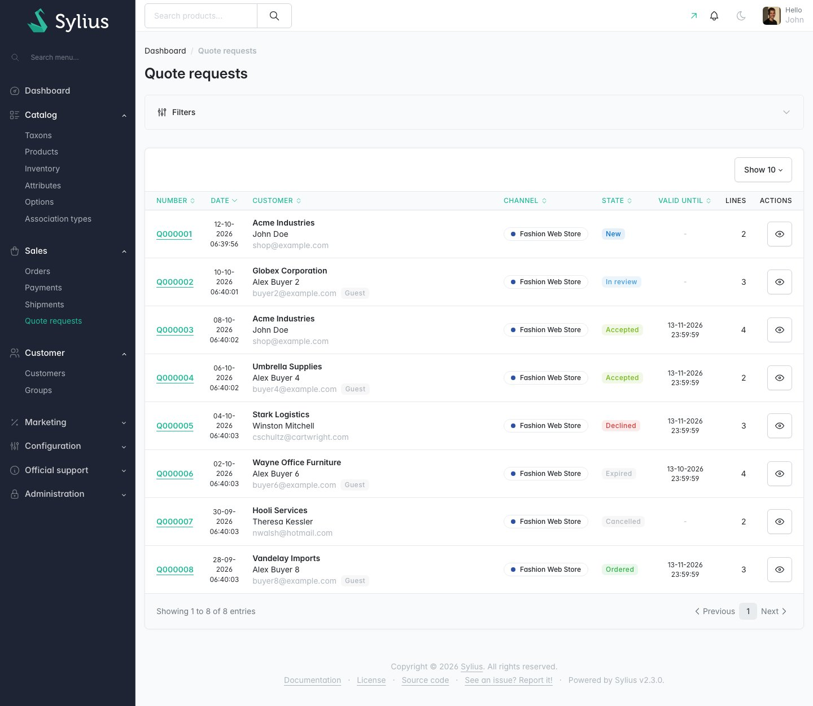
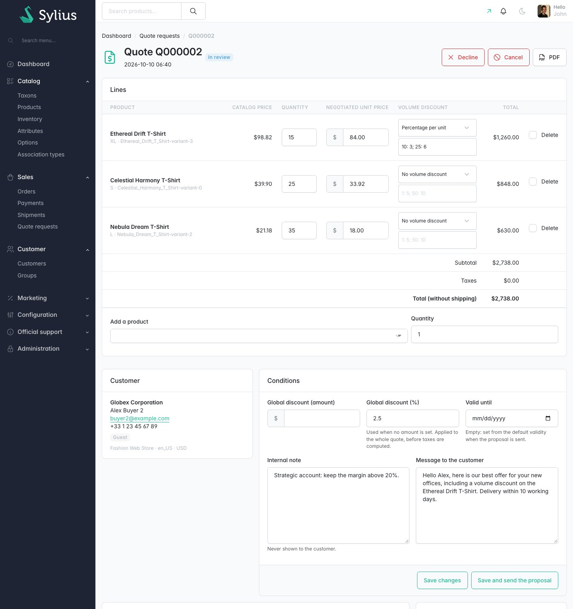

# Sylius Quote Request Plugin

> English: [README.md](README.md) <!-- vitrine:lang -->

[](https://github.com/thibmonier/sylius-quote-request-plugin/actions/workflows/build.yaml)
[](LICENSE)

**Demande de devis B2B (RFQ) pour Sylius 2 : les clients demandent un devis, le marchand négocie,
le client accepte et passe commande aux prix négociés.**

Les acheteurs en gros paient rarement le prix catalogue : ils demandent un devis pour 200 unités,
l'équipe commerciale répond avec ses prix, puis la commande suit. Le cœur de Sylius 2 n'a pas de
fonctionnalité de devis, et les plugins de devis open source
se sont arrêtés à Sylius 1.

Ce plugin ajoute toute la boucle à la boutique et à l'administration, et transforme un devis
accepté en commande Sylius classique dont les prix ne peuvent pas être modifiés par le traitement
du panier. Il est gratuit et open source.

## Fonctionnalités

**Boutique**

- *Demander un devis pour ce panier* sur la page du panier, et *Ajouter au devis* sur les pages
  produit (variante + quantité, plusieurs produits peuvent être rassemblés avant l'envoi).
- Formulaire de demande : entreprise, prénom et nom, e-mail, téléphone, numéro de TVA / d'entreprise
  (facultatif), message et quantité souhaitée de chaque produit. Les clients connectés ont leurs
  informations préremplies ; les invités sont les bienvenus (configurable).
- **Mes devis** dans le compte client : liste et détail avec le statut, les lignes, les prix
  proposés, la date de validité et le fil de messages. Le client accepte, refuse, demande des
  modifications (avec un message) ou annule une demande encore en cours d'examen.
- Les invités suivent leur devis grâce à un **lien secret** envoyé par e-mail (jeton aléatoire de
  256 bits), avec les mêmes actions.
- **Acceptation → panier aux prix verrouillés → tunnel de commande classique.** L'acceptation crée
  un panier contenant exactement les lignes du devis aux prix négociés ; le client choisit la
  livraison et le paiement comme d'habitude, et la commande est liée au devis, qui passe à
  *commandé*. La page du panier indique que le panier provient d'un devis, avec un bouton pour
  revenir aux prix catalogue.

**Administration** (*Ventes → Demandes de devis*)

- Grille avec filtres : statut, numéro, client (e-mail, entreprise, nom), canal, date.
- Page du devis : modification des quantités, **remplacement des prix unitaires**, **remises sur
  volume par ligne** (pourcentage ou montant par unité, par paliers de quantité comme
  `10: 5; 50: 10`), suppression de lignes, ajout de produits (autocomplétion), **remise globale**
  (montant ou pourcentage) avec une **suggestion de groupe de clients** facultative (un clic pour
  l'appliquer), date de validité, note interne, message au client, totaux avec les taxes du canal.
- Actions : *Enregistrer*, *Enregistrer et envoyer la proposition* (e-mail), démarrer l'examen,
  modifier une proposition envoyée, refuser, marquer comme expiré, annuler, **PDF**, et deux façons
  de passer la commande à la place du client : **Convertir en commande maintenant** (un clic :
  adresse par défaut du client, modes de livraison et de paiement par défaut, paiement en attente)
  ou **Convertir en commande** (adresse et modes choisis par le marchand).

**PDF du devis** (moteur facultatif)

- L'administrateur et le client téléchargent un PDF de la proposition : numéro, données de
  facturation du vendeur (données de facturation de la boutique du canal), client, lignes avec prix
  catalogue, prix négocié, remise sur volume, remise globale, taxes, totaux et date de validité. Il
  est joint à l'e-mail de *proposition*.
- Moteur par défaut : wkhtmltopdf via `knplabs/knp-snappy` (`knp_snappy.pdf` de KnpSnappyBundle, ou
  `pdf_binary`). Sans moteur, les liens et pièces jointes PDF sont simplement masqués. Remplacez le
  service `tmonier_quote_request.pdf_generator` (`QuotePdfGeneratorInterface`) pour utiliser un autre
  moteur.
- Fil de messages partagé avec le client.

**Sous le capot**

- Symfony Workflow `tmonier_quote_request` : `new → in_review → proposed → accepted → ordered`,
  plus `declined`, `expired`, `cancelled` (et `proposed → in_review` quand la proposition est
  modifiée ou quand le client demande des modifications). Une proposition ne peut être acceptée que
  tant qu'elle est valide.
- `tmonier:quote-request:expire` marque comme expirées les propositions dont la date de validité est
  dépassée (à lancer depuis cron).
- E-mails via le mailer de Sylius : nouvelle demande (marchand + accusé de réception au client),
  proposition (client), acceptation (marchand), messages (l'autre partie).
- Événements pour les intégrateurs : `tmonier_quote_request.created`, `.proposed`, `.accepted`,
  `.ordered`, `.declined`, `.expired`, `.cancelled`, `.changes_requested`, `.message_posted`.
- Fixture de démonstration `tmonier_quote_request` (devis dans tous les statuts, dont un commandé).
- Traductions en anglais, français, allemand, espagnol, italien, néerlandais et polonais ; Twig
  Hooks ; migrations MySQL, MariaDB et PostgreSQL.

## Comment les prix négociés résistent au traitement de la commande

Sylius recalcule chaque panier (`sylius.order_processor`) : prix issus de la tarification du canal,
promotions, livraison, taxes. Le plugin s'insère dans cette chaîne au lieu de lutter contre elle :

1. Les articles du panier d'un devis accepté sont **immuables** (`OrderItem::$immutable`, un
   indicateur du cœur) : le recalculateur de prix de Sylius les ignore.
2. Un processeur de priorité 45 (après le recalculateur de prix, avant la livraison, les promotions
   et les taxes) réapplique le devis à chaque traitement : mêmes variantes et mêmes quantités, prix
   unitaire = prix négocié moins la remise sur volume du palier atteint, remise globale répartie sur
   les unités sous forme d'ajustement de promotion de commande (code d'origine
   `tmonier_quote_request`). Si le client modifie le panier, le contenu du devis revient.
3. Le processeur de promotions est décoré : par défaut, **les promotions de panier et les coupons ne
   sont pas appliqués** à un panier de devis (`allow_promotions: true` pour les autoriser). Les
   promotions de catalogue font partie du prix catalogue et ne touchent jamais au prix négocié.
4. Les **taxes** sont calculées par Sylius comme d'habitude, sur les prix négociés remisés, avec la
   zone de taxation de l'adresse du client ; les prix suivent la convention de vos taux de taxe
   (inclus dans le prix ou non). La **livraison** est choisie et facturée dans le tunnel de commande.

Les totaux affichés sur le devis sont calculés de la même façon (une commande transitoire passe par
le même synchroniseur et par le processeur de taxes de Sylius), avec la zone de l'adresse par défaut
du client ou la zone de taxation par défaut du canal.

## Captures d'écran













## Prérequis

| | Version |
|---|---|
| PHP | 8.2+ |
| Sylius | 2.2.9+, 2.3 (correctifs de sécurité GHSA-2rv4-pjmm-7fxf, GHSA-vv4h-q2x8-74g4) |
| Symfony | 7.4, 8.0 |

Machines à états : le graphe du devis `tmonier_quote_request` est toujours associé à l'adaptateur
Symfony Workflow (`graphs_to_adapters_mapping`), il fonctionne donc même quand la boutique garde
`default_adapter: winzou_state_machine`. Le devis passe à *commandé* sur
`workflow.sylius_order_checkout.completed.complete` (adaptateur Symfony Workflow, le défaut de
Sylius 2) et, quel que soit l'adaptateur (Winzou compris), quand une commande dont l'état de tunnel
de commande devient `completed` est enregistrée (écouteur Doctrine `onFlush`, événement émis sur
`postFlush`). Les deux chemins sont testés.

Facultatif : `knplabs/knp-snappy-bundle` (ou `knplabs/knp-snappy` avec `pdf_binary`) et wkhtmltopdf
pour le PDF du devis. Obligatoire : `symfony/rate-limiter` (limitation de débit des invités).

## Installation

1. Ajoutez le paquet :

    ```bash
    composer require tmonier/sylius-quote-request-plugin
    ```

2. Enregistrez le bundle dans `config/bundles.php` :

    ```php
    Tmonier\SyliusQuoteRequestPlugin\TmonierSyliusQuoteRequestPlugin::class => ['all' => true],
    ```

3. Importez la configuration dans `config/packages/tmonier_sylius_quote_request.yaml` :

    ```yaml
    imports:
        - { resource: "@TmonierSyliusQuoteRequestPlugin/config/config.yaml" }
    ```

4. Importez les routes (administration et boutique) dans `config/routes/tmonier_sylius_quote_request.yaml` :

    ```yaml
    tmonier_sylius_quote_request:
        resource: "@TmonierSyliusQuoteRequestPlugin/config/routes.yaml"
    ```

5. Lancez la migration (trois tables : `tmonier_quote_request`, `tmonier_quote_request_line`,
   `tmonier_quote_request_message`) :

    ```bash
    bin/console doctrine:migrations:migrate
    ```

6. Faites expirer les anciennes propositions chaque nuit :

    ```
    15 2 * * * cd /var/www/shop && bin/console tmonier:quote-request:expire
    ```

## Configuration

```yaml
# config/packages/tmonier_sylius_quote_request.yaml
tmonier_sylius_quote_request:
    allow_guests: true          # visitors without account can request a quote
    default_validity_days: 30   # validity of a proposal sent without date
    admin_email: ~              # merchant notifications; the channel contact e-mail when null
    from_product_page: true     # "Add to quote request" on product pages
    from_cart: true             # "Request a quote for this cart" on the cart page
    allow_promotions: false     # cart promotions on top of the negotiated prices
    max_lines: 100              # lines of one request
    customer_group_discounts:   # global discount (%) suggested by customer group code
        wholesale: 12.5
    pdf_binary: ~               # wkhtmltopdf path, with knplabs/knp-snappy, when KnpSnappyBundle is not installed
    base_url: ~                 # base of the links in the e-mails; the channel hostname when null
    checkout_idle_minutes: 30   # the merchant converts a quote whose cart checkout was abandoned that long ago
    pdf_attachment_directory: '%kernel.project_dir%/var/tmonier_quote_request/pdf' # proposal PDFs, kept 48 h (created 0775)
    rate_limit:                 # valid quote requests (guests and customers), messages, and quote transitions (accept/decline/cancel)
        enabled: true
        per_ip: 10              # IPv6: per /56 network; IPv4-mapped addresses count as IPv4
        per_email: 3            # case, +tag and Gmail dots ignored
        messages_per_ip: 30     # also caps transitions per IP
        messages_per_quote: 10  # also caps transitions per quote (token)
        interval: '1 hour'
        cache_pool: cache.rate_limiter
```

Les dates de validité sont enregistrées en fin de journée (23:59:59) dans le fuseau horaire PHP par
défaut : utilisez le même `date.timezone` pour PHP-FPM et pour le cron qui lance
`tmonier:quote-request:expire`.

`allow_guests` (comme les autres indicateurs) accepte une variable d'environnement, par exemple
`'%env(bool:QUOTE_ALLOW_GUESTS)%'`.

Les modèles, le dépôt et les fabriques sont des ressources Sylius
(`tmonier_quote_request.quote_request`, `.quote_request_line`, `.quote_message`) et peuvent être
remplacés sous `tmonier_sylius_quote_request.resources`. Les modèles d'e-mail sont les e-mails du
mailer de Sylius `tmonier_quote_request_*` (voir `config/app/mailer.yaml`).

## Événements

```php
use Tmonier\SyliusQuoteRequestPlugin\Event\QuoteRequestEvent;
use Tmonier\SyliusQuoteRequestPlugin\Event\QuoteRequestEvents;

#[AsEventListener(event: QuoteRequestEvents::ACCEPTED)]
public function onAccepted(QuoteRequestEvent $event): void
{
    $quote = $event->getQuoteRequest(); // $quote->getOrder() is the cart with the locked prices
}
```

Les événements des opérations que le plugin exécute dans sa propre transaction (acceptation,
conversion par le marchand, transitions du marchand et du client) sont émis juste après la
validation de cette transaction, dans l'ordre des changements (`accepted` avant `ordered`), et pas
du tout si elle est annulée.

**Limitation :** les événements levés dans une transaction que le plugin ne possède pas (une
commande de l'API Sylius derrière le middleware messenger `doctrine_transaction`, le flush de
finalisation du tunnel de commande qui fait passer un devis à *commandé*, tout appelant qui enveloppe
le plugin dans sa propre transaction) sont émis immédiatement, sur postFlush, comme les événements
du cœur de Sylius : les écouteurs peuvent s'exécuter avant la validation de la transaction englobante
et ne sont pas annulés si elle est annulée. Un écouteur qui échoue après une validation (par exemple
parce que le serveur de messagerie est indisponible) est journalisé et signalé par un message flash
d'avertissement ; les autres écouteurs et événements s'exécutent quand même et l'opération n'est pas
signalée comme échouée. Pour des intégrations fiables (ERP, webhooks), enregistrez les événements
dans une outbox, par exemple
[tmonier/sylius-webhook-outbox-plugin](https://github.com/thibmonier/sylius-webhook-outbox-plugin). Ce
que les écouteurs de `ordered` persistent est enregistré juste après eux, quel que soit l'adaptateur
de machine à états. Les événements Symfony Workflow de `tmonier_quote_request` sont également
disponibles.

## Intégration avec d'autres plugins

- **Processeurs de commande.** `QuotePriceLockProcessor` est un `sylius.order_processor` de priorité
  **45** : après le nettoyeur d'ajustements (60) et le recalculateur de prix (50), avant la livraison
  (40), les promotions (20) et les taxes (10). Un plugin de tarification (par exemple les prix
  dégressifs) doit s'exécuter à une priorité **<= 44** et laisser les articles `immutable` tranquilles.
- **Le contrat `immutable`.** Les articles d'un panier de devis sont `OrderItem::$immutable` (le
  recalculateur de prix de Sylius les ignore) et portent un ajustement `tmonier_quote_lock`. Quand un
  panier perd son devis (libéré, annulé, conversion par le marchand), le plugin rend de nouveau les
  articles modifiables et lance le recalculateur de prix de Sylius : prix catalogue d'abord, puis tout
  processeur enregistré après 45 s'applique comme d'habitude. Ne définissez pas vous-même `immutable`
  sur les articles d'un panier de devis, et ne les déverrouillez pas.
- **Paniers de devis.** `Tmonier\SyliusQuoteRequestPlugin\Checkout\QuoteCartCheckerInterface::isQuoteCart($order)`
  indique si un panier est celui d'un devis accepté : son contenu est restauré à chaque traitement,
  donc un ajout groupé au panier (commande rapide...) doit refuser ou rediriger vers un panier
  classique. Identifiant de service `tmonier_quote_request.quote_cart_checker` (API publique stable,
  aussi aliasée par l'interface) ; tmonier/sylius-quick-order-plugin l'utilise lorsqu'il est installé.
- **Événements** : voir plus haut ; pour les intégrations, préférez une outbox.

## Sécurité

- Le lien secret est l'accès aux devis des **invités** : jetons de 256 bits, comparés en temps
  constant (sensibles à la casse même avec les collations MySQL), limités au canal du devis. Toute
  personne qui détient le lien peut consulter et accepter un devis d'invité (comme indiqué dans
  l'e-mail).
- Les devis d'un **compte boutique** exigent que leur propriétaire soit connecté, lien ou non (les
  autres clients reçoivent une erreur 403, les visiteurs la page de connexion) ; leurs e-mails
  renvoient vers *Mes devis*. Le panier d'un devis accepté n'est jamais remis à un autre client.
- Les demandes de devis sont limitées en débit par IP (IPv6 /56) et par boîte e-mail (les
  sous-adresses et les points Gmail comptent pour une seule) ; les messages et les transitions de
  devis (accepter / refuser / annuler) partagent le budget `messages_per_ip` / `messages_per_quote`,
  ce qui empêche un détenteur de jeton de marteler le point d'entrée des transitions ; seules les
  soumissions valides comptent. Un champ pot de miel écarte les robots. Les e-mails au client ne
  répètent jamais les coordonnées saisies dans le formulaire (le destinataire n'est pas forcément
  l'auteur) ; l'e-mail du marchand les conserve.
- Les liens des e-mails proviennent de `base_url` ou du nom d'hôte du canal (le schéma suit
  `sylius.unsecured_urls`) ; à défaut, de l'URI par défaut du routeur ou de la requête : définissez
  `framework.trusted_hosts` (ou `base_url`).
- Chaque action est un POST avec un jeton CSRF ; les pages d'administration sont derrière le
  pare-feu d'administration de Sylius. Les clients ne peuvent qu'annuler une demande en cours ou
  refuser une proposition.
- Les saisies du client sont échappées dans les e-mails (la mise en page des e-mails de Sylius
  désactive l'échappement automatique) et dans le PDF ; wkhtmltopdf s'exécute avec
  `--disable-local-file-access` et `--disable-javascript`.
- L'acceptation et la conversion vérifient que chaque produit peut encore être commandé (activé,
  vendu dans le canal, stock pour les variantes suivies) : pas de commande partielle ni vide. La
  conversion exécute la validation `sylius_checkout_complete` du tunnel de commande de la boutique,
  conserve le mode de livraison choisi ou échoue, et est atomique.
- Concurrence : chaque modification d'un devis verrouille sa ligne ; les décisions sur son panier
  (acceptation, début du tunnel de commande, conversion) vérifient aussi et incrémentent une version,
  de sorte qu'une décision prise sur un devis périmé est refusée (testé avec deux connexions). Les
  messages et les modifications du marchand ne font jamais échouer une demande concurrente, et le
  devis ne fait jamais échouer la finalisation d'un tunnel de commande.
- Invariant : un panier ne contient des articles aux prix du devis que s'il est le panier du devis
  accepté qui les détient (articles marqués par un ajustement `tmonier_quote_lock`). Tout autre panier
  retrouve les prix catalogue à son prochain traitement, et la finalisation de son tunnel de commande
  est refusée (garde Symfony Workflow et contrôle Doctrine pour tout adaptateur). Une commande qui ne
  contient pas les lignes du devis ne fait jamais passer le devis à « commandé ».
- Une conversion par le marchand reprend le panier de devis du client (vidé), sauf si le client est
  dans son tunnel de commande : elle attend alors que le panier soit inactif depuis
  `checkout_idle_minutes`.
- Une fois un devis commandé (tunnel de commande du client ou conversion par le marchand), les
  quantités demandées de ses produits quittent le panier à partir duquel la demande a été faite
  (« Demander un devis pour ce panier »), sauf si ce panier en est à l'étape de paiement et a été
  utilisé dans les `checkout_idle_minutes` ; le reste du panier et les autres paniers ne sont pas
  touchés.
- Les limiteurs de débit utilisent le composant lock (le plugin active `framework.lock` avec le
  store flock sauf si l'application le configure) : les requêtes parallèles respectent les limites
  (testé).

## Limitations

- Doctrine DBAL 3 (Sylius 2.2) : quand le plugin s'exécute dans la transaction d'un appelant (par
  exemple une commande d'API derrière le middleware messenger `doctrine_transaction`) et que
  `use_savepoints` est désactivé, l'échec d'une opération du plugin marque la transaction de
  l'appelant en rollback-only. Activez `doctrine.dbal.use_savepoints: true` (toujours actif avec
  DBAL 4).
- Une seule devise par devis : la devise de base du canal.
- Les frais de livraison ne font pas partie du devis ; ils sont choisis et facturés dans le tunnel de
  commande.
- Les lignes sont des variantes de produit du catalogue (pas de ligne en texte libre, pas de pièce
  jointe).
- Les remises sur volume en montant supposent une devise à 2 décimales.
- Les clés de limitation de débit ne replient que le sous-adressage `+tag` (tous les fournisseurs) et
  les points Gmail ; les autres alias de fournisseurs comptent comme des boîtes distinctes.
- Le PDF de l'e-mail de proposition est joint par chemin (mailer de Sylius) : chaque PDF est écrit
  dans un fichier au nom unique (`tmonier_quote_<number>-<random>.pdf`, 0644) dans
  `pdf_attachment_directory` (par défaut `%kernel.project_dir%/var/tmonier_quote_request/pdf`) et
  supprimé après 48 heures, afin qu'un worker de mailer asynchrone puisse le lire. Le répertoire est
  créé en 0775 s'il manque (un répertoire existant garde ses permissions) : exécutez php-fpm, la
  console et les workers avec un groupe commun, ou accordez-leur une ACL, par exemple
  `setfacl -R -m u:www-data:rwX -m d:u:www-data:rwX var/tmonier_quote_request`. Avec des workers sur
  d'autres hôtes, utilisez un répertoire partagé ou envoyez les e-mails de façon synchrone.
- Un moteur PDF qui échoue envoie la proposition sans pièce jointe et en avertit le marchand.
- Un produit désactivé ou retiré du canal après l'acceptation quitte le panier de devis (avec sa part
  d'une remise globale fixe) ; le client en est informé sur la page du devis.
- La mise en page du PDF est un unique modèle Twig (`templates/pdf/quote.html.twig`), à remplacer
  dans votre thème ou votre répertoire de modèles.
- Un panier de devis ne peut pas être mélangé à d'autres produits : quitter les prix du devis ramène
  le panier aux prix catalogue, le devis reste accepté et peut démarrer un nouveau panier plus tard.
- Les invités qui acceptent un devis passent commande en tant qu'invités (e-mail demandé par le
  tunnel de commande).
- La conversion depuis l'administration utilise l'adresse et les modes saisis par le marchand ; le
  stock et le paiement suivent les règles Sylius habituelles (la commande est passée avec un nouveau
  paiement).
- Pas encore de points d'entrée API Platform.

## Développement

Voir [CLAUDE.md](CLAUDE.md) pour les commandes et [SPEC.md](SPEC.md) pour la recherche et les
décisions de conception.

<!-- vitrine:demo-b2b:start -->
## Démo B2B

Ce plugin est utilisé dans la [démo B2B Sylius](https://github.com/thibmonier/sylius-b2b-demo) : une boutique Sylius 2.3 avec des données d'exemple fictives, où les plugins B2B fonctionnent ensemble. Le code source, l'installation et les fixtures de la démo sont dans ce dépôt.

- Démo en ligne : [sylius-b2b.thibaut-monier.fr](https://sylius-b2b.thibaut-monier.fr)
- Auteur : [Thibaut Monier](https://www.linkedin.com/in/thibautmonier/)

La démo est un exemple, pas une configuration de production.
<!-- vitrine:demo-b2b:end -->

## Licence

MIT, voir [LICENSE](LICENSE).
